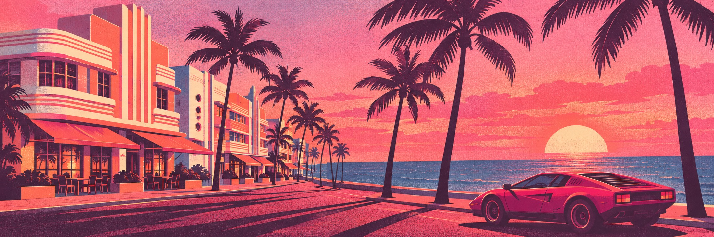

# LEONIDA

**Xbox Edition for PC · Independent GTA VI fan project**

LEONIDA is an independent GTA VI emulation project for Windows. Explore five proposed PC configurations across GeForce and Radeon hardware, from native 1080p to 4K. The first public Windows executable is planned for winter.

## Xbox Edition for PC

LEONIDA is preparing an Xbox-inspired Windows edition. The winter preview pairs a terminal-style project dashboard with an original playable browser scene. [Read the edition dossier](preview/docs/xbox-edition.md).

## Winter browser demo

**Soon · December 22, 2026.** The four-week preview includes an original coastal drive with keyboard and touch controls. Download the repository ZIP, extract it and open `preview/index.html` to play offline. [Explore the browser demo](preview/README.md).

## PC profiles

Each row pairs a proposed test machine with a native resolution and frame-rate goal. Measured results and minimum system requirements are pending.

| Profile | Processor | Graphics | RAM | Native resolution | FPS target |
| :--- | :--- | :--- | ---: | ---: | ---: |
| 1080p baseline | Ryzen 5 3600 | GeForce GTX 1660 Super | 16 GB | 1920 × 1080 | 30 |
| 1080p performance | Core i5-12400F | Radeon RX 6700 XT | 16 GB | 1920 × 1080 | 60 |
| 1440p reference | Ryzen 7 5800X3D | GeForce RTX 4070 | 32 GB | 2560 × 1440 | 60 |
| 1440p Radeon | Ryzen 7 5800X3D | Radeon RX 7800 XT | 32 GB | 2560 × 1440 | 60 |
| 4K resolution test | Ryzen 7 7800X3D | GeForce RTX 4080 | 32 GB | 3840 × 2160 | 30 |

**How to read the profiles.** The two 1440p machines share a processor, memory capacity and frame-rate goal so testers can compare GeForce and Radeon captures over the same route. The 4K profile trades frame rate for resolution: its 30 FPS target allows 33.33 ms per frame, versus 16.67 ms for the 1440p target. All five profiles specify 100% render scale with upscaling and frame generation disabled.

[Explore all five profile specifications](profiles/leonida-pc.json) · [Inspect the RTX 4070 reference](profiles/rtx-4070-native-1440p.json) · [Windows release notes](releases/README.md)

## Frame pacing

At native 1440p, a single frame contains **3,686,400 output pixels**. At 60 frames per second, the renderer has **16.67 ms per frame**. The profile keeps upscaling and frame generation disabled so the capture can report how frequently the application presents a rendered frame.

### Frame-time reference

These figures come from dividing 1,000 milliseconds by the frame rate. They provide a scale for reading a future capture.

| Frame rate | Time per frame at steady pacing | Difference from the 60 FPS budget |
| ---: | ---: | ---: |
| 30 FPS | 33.33 ms | 16.67 ms over |
| 40 FPS | 25.00 ms | 8.33 ms over |
| 50 FPS | 20.00 ms | 3.33 ms over |
| **60 FPS** | **16.67 ms** | **On budget** |
| 90 FPS | 11.11 ms | 5.56 ms under |
| 120 FPS | 8.33 ms | 8.33 ms under |

A 50 ms frame occupies the time of three evenly paced frames at 60 FPS. That hitch can be visible in a camera pan even when the average FPS for the whole route stays near 60. The benchmark sheet therefore pairs average FPS with the 99th-percentile frame time.

### Resolution reference

| Output resolution | Pixels per frame | Relative to native 1440p | Output pixels per second at 60 FPS |
| :--- | ---: | ---: | ---: |
| 1920 × 1080 | 2.07 million | 56.25% | 124.42 million |
| **2560 × 1440** | **3.69 million** | **100%** | **221.18 million** |
| 3840 × 2160 | 8.29 million | 225% | 497.66 million |

The table counts output pixels. Actual GPU cost also depends on scene complexity, materials, shadows and post-processing. A resolution change alone cannot predict the frame rate of the development build.

## Gameplay compatibility

The **17% figure** is the maintainer’s estimate of how much gameplay currently runs. Its scope is still open: the repository does not yet identify a mission list, a test route or a denominator. Readers can use the following proposed checks to interpret the next compatibility update.

| Proposed test | What a passing report would document |
| :--- | :--- |
| Start a session | Build ID, starting state and the point where player input becomes available |
| Traverse the world | A named route, travel time and any stalls or missing assets |
| Complete a mission | Mission identifier, checkpoints reached and completion trigger |
| Resume from a save | Save location, restored mission state and response to the first player input |
| Repeat the run | Whether the same build reaches the same endpoint on a second attempt |

## Benchmark procedure

1. **Record the system.** Include the CPU, RAM, GPU, driver, Windows version and build identifier. Record any frame cap or VSync setting.
2. **Fix the route.** Use the same save, starting position, camera direction and endpoint. Keep loading screens outside the timed interval unless loading is the subject of the test.
3. **Separate the first pass from repeat passes.** Record one cold run and three repeat runs. Retain each capture so a smooth repeat pass cannot hide a first-pass stall.
4. **Report frame pacing.** For each pass, list the capture duration, average FPS and 99th-percentile frame time. Attach the raw frame times and identify where the largest hitch occurred.

A reader should be able to select a build, repeat the route and compare the same interval. The [benchmark report template](BENCHMARK.md) provides the fields for a submission.

## Windows release

**Coming in winter.** The planned download is the LEONIDA Windows executable. Build number, release date and download link are pending. [Follow the Windows release preview](releases/README.md).

*LEONIDA is an independent fan project, unaffiliated with Rockstar Games or Take-Two Interactive. The cover is original concept art.*
