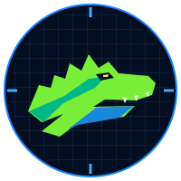

# LEONIDA

**Xbox Edition for PC · Winter preview · December 22, 2026**

LEONIDA is an independent GTA VI fan project preparing a Windows edition inspired by the Xbox release. We believe players should have more say than a corporate platform in how they play. Our first public preview is a small coastal drive that runs entirely in your browser.

## Play the browser demo

Download and extract the project, then open **index.html**. Choose **Launch drive** and steer using the arrow keys or the on-screen buttons. The page, artwork and demo work offline.

## Repository guide

| Directory | Contents |
| --- | --- |
| [assets](assets/) | Original alligator emblem |
| [docs](docs/xbox-edition.md) | Xbox Edition plans and winter release status |
| [runtime](runtime/) | Browser driving scene and countdown logic |
| [viewer](viewer/) | Responsive terminal interface |

## Coming soon

The project preview is scheduled for December 22, four weeks after the November 24 announcement. Windows executable availability will be announced separately. [Read the edition notes](docs/xbox-edition.md).
