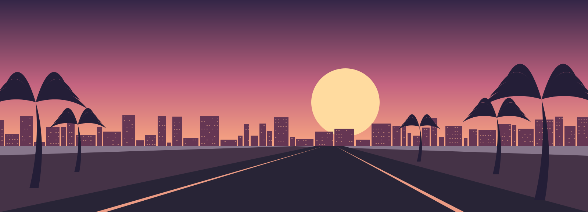

# LEONIDA

**Independent GTA VI fan project · Winter preview**

Take a short drive along an illustrated coastal highway. Steer with the arrow keys or the on-screen controls, watch the distance counter, and pause anywhere along the route. The demo is a standalone browser scene created for LEONIDA.

## Open the demo

Download the repository using **Code → Download ZIP**, extract it and open **index.html** in a browser. Keep **coast.svg** beside the HTML file. The page works offline and requires no installation.

## Soon. December 22, 2026.

The four-week countdown runs from November 24 to December 22 at 00:00 UTC. It marks the planned winter preview. A Windows executable and measured gameplay benchmarks are pending.

## Visual references

- **Ocean Drive at dusk.** Coral light on the skyline gives way to a dark violet road.
- **The coastal highway.** Lane markings converge at the horizon while a rose-colored coupe follows steering input.
- **Winter reveal.** A live countdown sits beneath the drive and changes to a date-reached message when the preview window opens.

## Project files

| File | Contents |
| --- | --- |
| [index.html](index.html) | English landing page, countdown and interactive drive |
| [coast.svg](coast.svg) | Original vector artwork shared by the page and the demo |

Independent fan project, unaffiliated with Rockstar Games or Take-Two Interactive.
